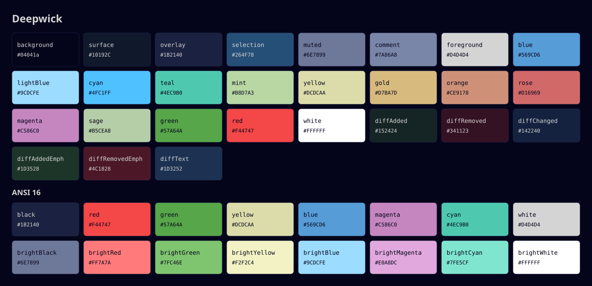

# Deepwick

A deep navy theme with Visual Studio 2022's familiar syntax colors, for every
tool you use. This repository is the **specification**: the palette, the rules
every port follows, and the tools that check them.

> Deepwick is an unofficial theme derived from
> [Polywick Blue](https://vscode.polywickstudio.net) by Polywick Studio (MIT).
> Not affiliated with Polywick Studio.



## Palette

Contrast is the WCAG 2.x ratio against Background. Every color used for text is
at least 4.5:1.

| Name | Hex | Role | Contrast |
|---|---|---|---|
| Background | `#04041a` | main surface | — |
| Surface | `#10192C` | current line, panels, status bars | 1.15 |
| Overlay | `#1B2140` | borders, inactive UI | 1.29 |
| Selection | `#264F78` | selection, visual mode | 2.38 |
| Muted | `#6E7899` | line numbers, hints, tag brackets | 4.64 |
| Comment | `#7A86A8` | comments, *italic* | 5.59 |
| Foreground | `#D4D4D4` | default text, operators | 13.66 |
| Blue | `#569CD6` | keywords, language constants, tags, headings | 6.87 |
| Light Blue | `#9CDCFE` | variables, parameters, properties | 13.57 |
| Cyan | `#4FC1FF` | readonly variables, enum members | 10.03 |
| Teal | `#4EC9B0` | types, classes, namespaces | 9.93 |
| Mint | `#B8D7A3` | interfaces, enums, type parameters, structs | 12.81 |
| Yellow | `#DCDCAA` | functions, methods, decorators | 14.32 |
| Gold | `#D7BA7D` | string escapes, CSS selectors, regex groups | 10.80 |
| Orange | `#CE9178` | strings, links, inline code | 7.66 |
| Rose | `#D16969` | regular expressions | 5.72 |
| Magenta | `#C586C0` | control flow, import/export, macros | 7.27 |
| Sage | `#B5CEA8` | numbers | 11.91 |
| Green | `#57A64A` | success, git added | 6.71 |
| Red | `#F44747` | errors, invalid, git removed | 5.63 |
| White | `#FFFFFF` | ANSI bright white, emphasis | 20.24 |

### Diff backgrounds

Solid blends of Green, Red, and Blue over Background, for diff lines and the
changed words inside them. Foreground stays at least 7:1 on each.

| Name | Hex | Role | Blend |
|---|---|---|---|
| diffAdded | `#152424` | added line background | 20% Green |
| diffRemoved | `#341123` | removed line background | 20% Red |
| diffChanged | `#142240` | changed line background | 20% Blue |
| diffAddedEmph | `#1D3528` | added words within a line | 30% Green |
| diffRemovedEmph | `#4C1828` | removed words within a line | 30% Red |
| diffText | `#1D3252` | changed words within a line | 30% Blue |

## ANSI 16

| Color | Normal | Bright |
|---|---|---|
| black | `#1B2140` (Overlay) | `#6E7899` (Muted) |
| red | `#F44747` (Red) | `#FF7A7A` |
| green | `#57A64A` (Green) | `#7FC46E` |
| yellow | `#DCDCAA` (Yellow) | `#F2F2C4` |
| blue | `#569CD6` (Blue) | `#9CDCFE` (Light Blue) |
| magenta | `#C586C0` (Magenta) | `#E0A8DC` |
| cyan | `#4EC9B0` (Teal) | `#7FE5CF` |
| white | `#D4D4D4` (Foreground) | `#FFFFFF` (White) |

The bright-only values `#FF7A7A`, `#7FC46E`, `#F2F2C4`, `#E0A8DC`, and
`#7FE5CF` may be used only in ANSI slots.

Terminal extras: background Background, foreground Foreground, cursor
Foreground, cursor text Background, selection Selection with Foreground text,
bold text Foreground.

## UI roles

| Role | Color |
|---|---|
| error | Red |
| warning | Yellow |
| info | Cyan |
| hint | Muted |
| success, git added | Green |
| git removed | Red |
| git modified | Blue |
| git untracked, new file | Teal |
| focused border, accent | Blue |
| inactive border | Overlay |
| search match | Selection background |
| current search match | Gold text on Selection |

## Syntax roles

Derived from Polywick Blue's TextMate and semantic token rules. Editor and
syntax-highlighter ports follow this table. Scopes are listed in full because
the most specific matching scope wins: a port that only styles `punctuation`
will paint comment markers and string quotes Foreground.

| Role | TextMate scopes | Semantic tokens | Color | Style |
|---|---|---|---|---|
| comment | `comment`, `punctuation.definition.comment`, `string.quoted.docstring`, `keyword.other.documentation`, `storage.type.class.jsdoc`, `storage.type.class.doxygen` | `comment` | Comment | italic |
| keyword | `keyword`, `storage.type`, `storage.modifier`, `constant.language`, `constant.other`, `variable.language.this`, `keyword.other.using`, `keyword.other.namespace`, Python `self` / `cls` (`variable.parameter.function.language.special.self`, `variable.parameter.function.language.special.cls`) | `keyword` | Blue |  |
| control flow | `keyword.control`, `keyword.operator.new`, `keyword.operator.expression`, `keyword.operator.cast`, `keyword.operator.sizeof`, `keyword.control.import`, `keyword.control.export`, `keyword.control.from` | — | Magenta |  |
| operator / punctuation | `keyword.operator`, `punctuation` | `operator` | Foreground |  |
| type | `entity.name.type`, `entity.name.class`, `entity.name.namespace`, `entity.name.scope-resolution`, `support.class`, `support.type` | `namespace`, `type`, `class` | Teal |  |
| interface / enum / struct | `entity.name.type.interface`, `entity.name.type.enum`, `entity.name.type.enum-member`, `entity.name.type.struct`, `storage.type.struct` | `interface`, `enum`, `struct`, `typeParameter` | Mint |  |
| function | `entity.name.function`, `entity.name.function.member`, `support.function`, `meta.function-call`, `support.function.magic`, `entity.name.function.decorator` | `function`, `method` | Yellow |  |
| macro | `entity.name.function.macro` | `macro` | Magenta |  |
| variable | `variable`, `entity.name.variable`, `variable.parameter`, `variable.other.property`, `variable.other.object.property`, `entity.other.attribute-name`, `support.type.property-name` (CSS, JSON) | `variable`, `parameter`, `property` | Light Blue |  |
| constant | `variable.other.constant` | `*.readonly`, `enumMember` | Cyan |  |
| string | `string`, `punctuation.definition.string`, `string.quoted.include`, `string.quoted.other.lt-gt.include`, `punctuation.definition.string.begin.include`, `punctuation.definition.string.end.include`, `support.constant.property-value` (CSS) | `string` | Orange |  |
| escape | `constant.character.escape`, `entity.other.attribute-name.class.css`, `entity.other.attribute-name.id.css`, `punctuation.definition.group.regexp`, `punctuation.definition.character-class.regexp` | — | Gold |  |
| regex | `string.regexp` | `regexp` | Rose |  |
| number | `constant.numeric` | `number` | Sage |  |
| tag | `entity.name.tag` | — | Blue |  |
| tag bracket | `punctuation.definition.tag` | — | Muted |  |
| preprocessor | `meta.preprocessor`, `entity.name.function.preprocessor` | — | Muted | bold |
| preprocessor keyword | `keyword.control.directive`, `keyword.preprocessor` | — | Foreground |  |
| label | `entity.name.label` | `label` | Foreground |  |
| heading | `markup.heading`, `entity.name.section.markdown` | — | Blue | bold |
| bold / italic | `markup.bold` / `markup.italic` | — | inherit | bold / italic |
| link / inline code | `markup.underline.link`, `markup.inline.raw`, `markup.fenced_code.block` | — | Orange |  |
| invalid | `invalid` | — | Red |  |
| deprecated | `invalid.deprecated` | `*.deprecated` | Foreground | strikethrough |

Source colors folded into the palette: struct `#86C691` → Mint; macro
`#BD63C5` → Magenta; preprocessor and tag bracket `#808080` → Muted; label
`#C8C8C8` → Foreground; include brackets `#E0B090` → Orange.

The machine-readable version of everything above is [`palette.json`](palette.json).

## Engine limitations

Some roles cannot be expressed by every highlighting engine. Ports state the
ones that apply in their README Notes, using these descriptions:

- **Tree-sitter without semantic tokens** (Neovim without LSP, Helix, Zed): no
  capture distinguishes interfaces, enums, and structs from other types, so the
  Mint role appears only where a language server supplies semantic tokens.
  Macro definitions are captured as macros (Magenta) rather than preprocessor
  (Muted bold).
- **Tree-sitter without per-language overrides** (Helix): Python's `and`,
  `or`, `not`, `is` share the capture used for `typeof`/`new`, so they take the
  control-flow color; Python builtin types take the keyword color.
- **Zed's Python grammar** captures control-flow keywords (`if`, `for`,
  `return`, `import`, …) and `and`/`or`/`not`/`is` as plain keywords, so they
  take the keyword color (Blue); builtin types take the type color (Teal).
- **TextMate grammars** (bat): no scope marks macro uses or C/C++ builtin types
  separately from other identifiers and keywords.
- **Terminal-rendered formats**: zsh `region_highlight` has no italic, so
  zsh-syntax-highlighting comments are not italic; bat draws italics only with
  `--italic-text=always`; Ptyxis has no selection color.

## Rules for ports

Each port lives in its own repository, `deepwick/<app>`.

1. **Palette only.** Every hex color in a port must be in `palette.json`.
   `check-palette` enforces this.
2. **Same roles, same colors.** Map to the UI and syntax roles above. Document
   app-specific choices in the port's README; propose general ones here.
3. **Italic comments** wherever the format supports it.
4. **Copy-pasteable install,** tested on the latest stable app version, which
   the README states.
5. **Credit line** in every README (see the top of this file).
6. **Screenshots** use the standard content in [`samples/`](samples):
   `sample.py`, `sample.ts`, `sample.c`, and `sample.md` for editors and
   highlighters; `terminal.sh` for terminals.

A port repository looks like:

```
deepwick/<app>/
├── <theme file(s)>
├── README.md
├── screenshot.png
├── .github/workflows/check.yml
├── .palette-allow          # only if needed
└── LICENSE
```

## Tools

Python 3.11+, no dependencies.

```sh
pip install "deepwick-spec @ git+https://github.com/deepwick/spec@main"

check-palette [PATH]      # report colors not in the palette (exit 1 if any)
check-port [PATH]         # check a port repo: README credit + tested version, LICENSE, CI, screenshot, palette
check-contrast            # verify text colors meet 4.5:1 on Background
deepwick-swatches -o swatches.svg
```

`check-palette` recognizes `#rgb`, `#rrggbb`, `#rrggbbaa`, `0xRRGGBB`,
`rgb(R, G, B)` / `rgba(R, G, B, A)`, and a bare `R,G,B` when it is the whole
value of a `key=value` line (Konsole's `Color=4,4,26`). Alpha is ignored when
the base color is in the palette. Two optional
files at the root of a port tune it:

- `.palette-allow` — extra permitted colors, one per line, as hex or `R,G,B`.
  Comments start with `# ` (hash, space): `#000000  # pure black required by the format`
- `.palette-ignore` — glob patterns of paths to skip, e.g. `vendor/`

Port CI is a single job:

```yaml
name: check
on: [push, pull_request]
jobs:
  palette:
    uses: deepwick/spec/.github/workflows/check.yml@main
```

## Development

```sh
uv run pytest
uv run check-contrast
uv run deepwick-swatches -o swatches.svg   # after editing palette.json
```

## License

MIT. See [LICENSE](LICENSE).
